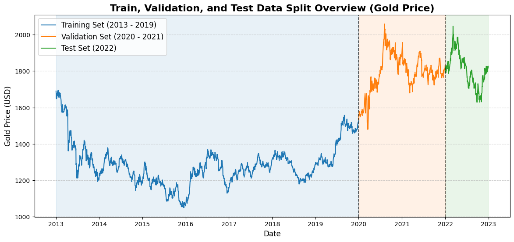
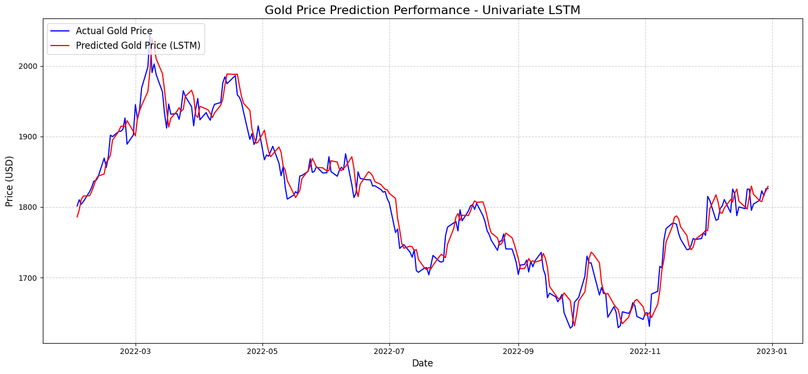
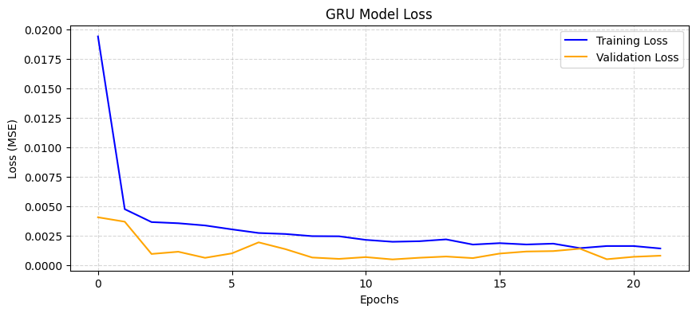

# Gold Price Forecasting with Recurrent and CNN–Recurrent Networks

## Overview

A collaborative academic time-series study comparing manually implemented LSTM and GRU components, with and without convolutional feature extraction, for **one-step-ahead univariate gold-price prediction**. The objective is to study temporal modeling under chronological evaluation rather than to provide an investment system.

**Evidence status:** Numerical results are recorded notebook outputs, checked against code and saved evaluation cells. They were not independently reproduced. Executable code uses a **21-observation input window**, despite older descriptive text referring to nine days.

## Key Features

- Chronological train/validation/test boundaries and training-only MinMaxScaler fitting.
- Price-trend, distribution, and yearly volatility exploration.
- Explicit custom LSTM gate computation and custom GRU recurrence.
- LSTM, GRU, CNN-LSTM, and CNN-GRU comparisons using inverse-scaled MAE, MSE, and R².
- Preserved prediction plots and training outputs.

## Technologies

Python, pandas, NumPy, scikit-learn, TensorFlow/Keras, Matplotlib, Seaborn, and Google Colab/Drive.

## Dataset

The notebook reads a Google Drive CSV named **`Gold Price (2013-2023).csv`** with `Date` and `Price` columns. The original provider, download URL, dataset license, and exact financial instrument/quotation basis are **not documented**. The CSV is not supplied. Plot labels and inverse-transform comments describe prices in USD, but the underlying quote convention is not independently verified.

Saved EDA reports **2,583 price observations**, with minimum 1,049.6 and maximum 2,058.4. Although the filename mentions 2023, executable split code uses training years through 2019, validation years 2020–2021, and test year 2022. These saved split counts sum to all 2,583 rows; a 2023 holdout experiment is not established.

| Split | Executable date condition | Raw rows | 21-step windows |
|---|---|---:|---:|
| Training | Year ≤ 2019 | 1,806 | 1,785 |
| Validation | 2020 ≤ year ≤ 2021 | 517 | 496 |
| Test | Year = 2022 | 260 | 239 |

## Methodology

1. Parse dates, sort ascending, strip commas from `Price`, and convert prices to floats. No explicit missing-value imputation, duplicate-date removal, or trading-calendar regularization is implemented.
2. Explore descriptive statistics, historical prices, a histogram/KDE, and yearly boxplots. A temporary `Year` EDA column is removed before modeling; the only model feature is past `Price`.
3. Split chronologically before scaling. Fit `MinMaxScaler((0, 1))` **only on training prices** and transform validation/test with the same fitted scaler. Future values can legitimately exceed the training scaling range.
4. Generate windows separately inside each split: `X = price[i:i+21]`, `y = price[i+21]`. The helper's default is 9, but all calls pass `window_size = 21`. Inputs have shape `(samples, 21, 1)`.
5. Train with Adam and MSE loss, batch size 32, and early stopping on validation loss with patience 10 and best-weight restoration. LSTM, CNN-LSTM, and CNN-GRU allow 50 epochs and explicitly use the 2020–2021 validation windows. Their calls retain Keras's default training shuffle behavior.
6. The standalone GRU instead allows **100 epochs**, sets `shuffle=False`, and uses `validation_split=0.1` from training windows rather than the dedicated 2020–2021 set. This is a different model-selection protocol.
7. Predict each held-out target from its preceding observed prices, inverse-transform both predictions and targets, and compute MAE, MSE, and R². Each test window uses actual historical test prices available before its target. This is **rolling one-step-ahead prediction**, not recursive multi-step forecasting.

## Model Architectures

| Model | Implemented structure |
|---|---|
| LSTM | `ManualLSTMCell(64)` wrapped in Keras RNN; manually computed input/forget/candidate/output gates; dropout 0.2; Dense 1. |
| CNN-LSTM | Conv1D 64 filters, kernel 3, same padding, ReLU; MaxPooling1D 2; the same manual 64-unit LSTM; dropout 0.2; Dense 1. |
| CNN-GRU | Same convolution/pooling frontend; custom GRU layers with 64 then 32 units, first returning sequences; dropout 0.2 after each; Dense 1. |
| GRU | Custom 64/32-unit GRU stack without a convolutional frontend; dropout 0.2 after each; Dense 1. |

`CustomGRU` explicitly computes update/reset gates and candidate state in a timestep loop, using `h = (1-z)*h + z*candidate`. It is not simply a call to the built-in Keras GRU. CNN padding is internal to the past-only input window and does not itself expose the future target.

## Experimental Results

Recorded evaluation cells 20, 30, 39, and 49 (zero-based). Metrics use inverse-scaled prices, with units following the notebook's USD convention:

| Model | MAE (USD) ↓ | MSE (USD²) ↓ | R² (unitless) ↑ | Validation used |
|---|---:|---:|---:|---|
| LSTM | 14.3657 | 345.8594 | 0.9614 | 2020–2021 |
| GRU | 17.4715 | 513.6533 | 0.9427 | Last 10% of training windows |
| CNN-LSTM | 22.7567 | 834.2350 | 0.9070 | 2020–2021 |
| CNN-GRU | 25.9042 | 1078.4833 | 0.8797 | 2020–2021 |

LSTM has the lowest recorded errors and highest R². The table records model comparisons, not causally isolated optimizations. The different GRU validation strategy and epoch budget limit direct architectural attribution.

Original markdown quotes CNN-GRU R² 0.9421 and LSTM R² 0.9588, inconsistent with adjacent saved executable outputs. Those narrative values are not used in this README. No percentage improvement, speed claim, multi-step result, or trading return is inferred.

## Visualizations







Original EDA and all four prediction figures are available with [cell/output provenance](assets/figures/README.md). No predictions or charts were regenerated.

## Installation and Usage

Use Python 3.11 as an initial environment choice. Dependency constraints are **unverified compatibility ranges**; no exact tested environment is supplied by the notebook.

Windows PowerShell, from the repository root:

```powershell
py -3.11 -m venv .venv
.\.venv\Scripts\python.exe -m pip install --upgrade pip
.\.venv\Scripts\python.exe -m pip install -r requirements.txt
.\.venv\Scripts\python.exe -m jupyter lab notebooks/main.ipynb
```

Obtain the original CSV from the academic project's authorized source; there is no verified public download link. For local Jupyter, skip/remove the Colab import and Drive mount lines in a working copy and point `file_path` to your CSV using a Windows raw string or forward-slash path. Confirm compatible `Date` and comma-formatted string `Price` columns; the existing `.str` cleaning assumes a string column.

For Colab, upload `notebooks/main.ipynb`, install the dependencies, mount your own Drive, and supply the CSV at the configured path. Google Drive authentication is interactive; no credentials belong in code. Review cells before running because sequential execution trains all four models and writes weights/figures into the working directory. No CSV, weight files, or training runs were created during portfolio preparation. CPU execution is possible; a compatible GPU runtime is optional. Do not assume the installed Python 3.14 static-review environment can run TensorFlow dependencies.

## Limitations

- Scaling is training-only and split boundaries precede window creation, so no future-target inclusion or full-data scaler fitting was found in the main pipeline. Raw-data ordering, duplicates, and missingness cannot be independently checked without the CSV.
- Windows are built separately for each split, dropping its first 21 target opportunities and not using prior-split context. “21 observations” is more precise than “21 calendar days” because calendar frequency is not validated.
- The standalone GRU's internal validation windows overlap in historical input observations with neighboring training windows. Its scaler is fitted on the entire outer training period, including the later internal validation segment. This weakens that internal validation isolation, although 2022 test prices are not used for fitting.
- Standalone GRU and the other models use different validation periods/epoch budgets. No fixed random seeds, repeated-run uncertainty, naive persistence baseline, or walk-forward backtest is provided.
- High R² on price levels does not establish forecasting value beyond a last-price baseline. No multi-step forecast, directional test, or economic evaluation is demonstrated.
- Original markdown window sizes and R² commentary disagree with saved code/outputs. Execution counts are absent, and original data, checkpoints, and exact package versions are unavailable; historical results remain unverified recorded outputs.

## Team Project and My Role

This was a **collaborative academic project**. My responsibilities included **data preprocessing, exploratory data analysis, and model development**. These are shared team experiments, and this repository does not imply sole authorship of all components. No software license is added without approval from the relevant rights holders.

## Future Improvements

- Establish dataset provenance, quote units, licensing, calendar frequency, and date-quality checks.
- Add persistence/classical baselines and rolling-origin validation with a consistent selection protocol for all models.
- Fit preprocessing only within each training fold and retain versioned configurations, seeds, and approved data manifests.
- Evaluate multi-step forecasting as a distinct future experiment, with horizon-specific metrics rather than reusing one-step results.
- Explore additional covariates only with timestamp availability checks to avoid look-ahead bias.
